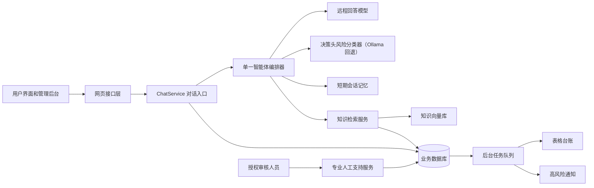
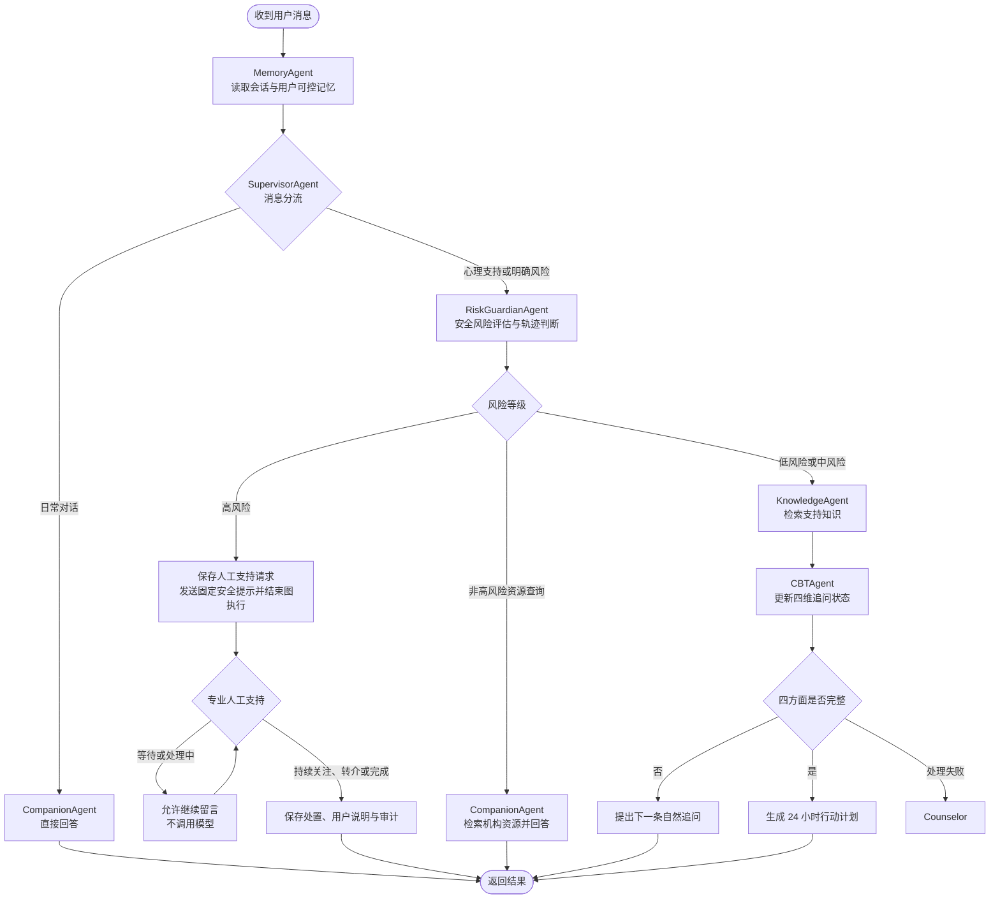

# Xling

Xling 是一个通用的心理健康支持与咨询辅助系统，帮助医院和大学承接心理支持需求并进行支持分流：非高风险需求由系统提供支持性对话、困扰梳理、知识和短期行动，高风险需求交由机构指定的医生或心理健康专业人员提供支持。

医疗诊断、药物建议和治疗决策由专业人员负责。部署机构负责组织专业支持人员、求助渠道和当地紧急资源，并完成必要的专业、法律与安全审查；系统中的通知或审核状态不等同于现实中的专业支持结果。

## 项目功能

- 日常对话与心理支持分流：普通问题直接回答，压力、焦虑、低落、睡眠和关系等困扰进入心理支持流程。
- 分层安全保护：明确危险信号优先由规则识别，再结合分类模型和近期风险变化，得到低、中、高三级安全风险。
- 专业支持与人工审核：高风险消息暂停常规自动支持并发送固定安全提示，进入医生或心理健康专业人员负责的处理路径；系统记录接手、人工回复、站外联系、持续关注、转介和完成处置，等待与处理中都允许用户继续补充情况。
- 认知行为四维追问：使用 CBT（认知行为方法，通过事件、想法、身体反应和行为四方面梳理困扰）逐步理解用户当前处境。
- 24 小时行动计划与次日反馈：四方面信息完整后生成可逐项执行的计划；次日反馈没有改善或情况恶化时可再次进入人工审核。
- 知识增强回答：使用 RAG（先检索知识库，再让模型依据相关内容回答）提供心理健康支持信息；机构热线和预约资源可通过后台知识上传提供，回答保留测试标识及预约快照日期。
- 用户可控记忆：分别管理当前会话、用户主动填写的支持背景和用户确认的长期记忆卡片；无记忆会话不会读取或新增长期记忆。
- 自愿量表筛查：提供 PHQ-9（抑郁相关筛查问卷）和 GAD-7（焦虑相关筛查问卷），结果只用于筛查与趋势参考，不作为诊断。
- 管理后台：查看安全评估、人工审核、对话、知识库、任务执行记录和失败任务。
- 可靠的报告与通知：安全记录、审核请求和后续任务先统一写入数据库，再由后台队列生成表格台账和发送高风险通知。
- 模型训练与评测：包含分类模型微调，以及分类、安全、检索、回答质量和端到端流程评测。

## 核心架构

Xling 采用“一个编排器 + 多个专职智能体”的架构。

所有智能体角色都在同一个应用进程中，由 LangGraph 的图连接和条件边决定执行顺序。每个节点读取原生 `GraphState` 中所需的业务字段，返回自己产生的字段更新；检查点只保存基础可序列化值，数据库连接和模型对象留在业务服务中。

LangGraph 是唯一编排框架，负责执行和保存检查点；依赖缺失时明确报错。每条新消息完整初始化本轮状态，避免上一轮的回复、风险评估、检索结果和业务事件残留。高风险轮次保存审核请求后直接结束图执行，不恢复旧中断；等待接手和处理中的补充消息进入同一人工支持记录，不调用模型。



架构的核心不是让模型自由决定一切，而是把安全顺序写成明确流程：先读取记忆并做消息分流；心理支持消息必须先完成安全风险评估，高风险消息不能先进入知识检索或普通回答。

## 智能体职责

| 智能体 | 职责 | 主要方式 |
| --- | --- | --- |
| `MemoryAgent` | 读取当前会话、支持背景和已确认记忆卡片，并生成简短记忆摘要 | 短期存储、业务数据库、模型摘要 |
| `SupervisorAgent` | 把消息分为日常对话、心理支持或明确风险 | 规则优先，模型补充 |
| `RiskGuardianAgent` | 判断低、中、高风险，并结合近期记录识别持续上升趋势 | 明确规则、分类模型、风险轨迹 |
| `KnowledgeAgent` | 改写检索词并查找相关知识内容 | 多查询＋Chroma dense 主检索，可配置归一化加权，向量不可用时使用本地混合检索 |
| `CBTAgent` | 完成四维追问；信息完整后生成 24 小时行动计划 | 结构化状态与模型生成 |
| `CompanionAgent` | 回答日常学习、编程和普通生活问题；回答经过既有分流的机构资源查询 | 通用对话模型；资源查询读取知识库 |
| `CounselorAgent` | 为非高风险心理支持生成非诊断性回复；高风险轮次不进入该节点 | 检索知识、明确图状态和模型生成 |

这些名称表示编排流程中的专职角色，不表示七个独立模型。回复模型、分类模型、数据库和知识库由这些角色按职责共享使用。

开发和实际联调采用“远程回答与语境复核 + 本地决策头主分类”的分工：日常回答、心理支持回复和结构化内容由兼容 OpenAI 的远程接口生成；安全分流先检查既有风险词规则，未命中时默认由应用进程内的单次前向决策头分类器评估（`CLASSIFIER_BACKEND=decision_head`）。高置信且无需语境复核的样本直接采用决策头结果；灰区、低置信或 margin 不足的样本由本机 Ollama 生成式分类器复核，非自身危险语境与部分隐晦即时危险由远程模型结合完整文本复核。决策头不可用时回退 Ollama，持续性或功能受损信号还会独立影响 LOW／MEDIUM 严重度。`mock` 模式用于无外部依赖的演示和自动测试，输出由固定规则模拟。

## 编排流程



每轮对话的用户消息、安全评估、人工审核请求和待执行任务在一次数据库事务中保存。模型生成的回复随后单独保存。表格和通知由后台任务执行，失败后会重试；超过重试次数的任务进入失败记录，避免阻塞用户回复或静默丢失。

## 数据与运行组件

| 组件 | 用途 |
| --- | --- |
| FastAPI（Python 网页服务框架） | 提供登录、对话、行动计划、筛查、管理后台和健康检查接口 |
| LangGraph | 统一执行智能体流程并保存原生图状态；高风险轮次结束图执行后由独立人工支持服务承接 |
| MySQL（关系型数据库） | 保存用户、会话、消息、筛查、计划、安全评估、审核和任务记录 |
| Redis（高速缓存服务） | 保存有时限的短期对话记忆和四维追问进度；不可用时有进程内降级存储 |
| Chroma（向量数据库） | 保存知识向量；在线默认使用原查询与多查询改写的 dense 结果，不再叠加 BM25 名次；可配置 dense＋BM25 归一化加权，启动时核对并修复索引，向量不可用时回退到本地关键词与文本相似度检索 |
| 兼容 OpenAI 的远程接口 | 提供回答模型；也可提供知识向量，或为知识向量单独配置另一服务商 |
| Ollama（本地模型运行工具） | 运行生成式回退风险分类器（默认决策头分类器在应用进程内运行，不依赖 Ollama）；仅在显式选择本地回答模式时同时承担回答模型 |
| 后台任务队列 | 非阻塞地生成表格台账、发送通知、重试失败任务并记录最终失败 |
| MCP | 模型上下文协议，用统一接口调用表格写入和风险通知工具；默认在线路径使用持久化队列 |
| Caddy | 作为部署入口，处理 HTTPS（加密网页连接）和请求转发 |

知识入库保留 Markdown 标题层级，在完整句子之间依据真实句向量的相邻距离选择语义边界；片段上限为 512 字。无法调用向量服务且允许回退时，使用保留标题和句界的结构分块。来源正文、分块配置与实际片段的指纹随数据库事务保存，避免未变化的内置知识在每次启动时重新编码；缺失或改动的片段仍会重新入库。

在线检索默认采用多查询＋Chroma dense 主检索：原查询与回答模型生成的最多 3 条改写查询全部参与，跨查询保留每个片段的最佳 dense 分数后合并去重；有效向量结果不再叠加 BM25 名次，无模型客户端或改写失败时保留原查询，向量不可用时回退本地混合评分。将 `KNOWLEDGE_RETRIEVAL_STRATEGY` 设为 `normalized_fusion` 可切回原 min-max 归一化加 0.98 向量权重的融合方式。BM25 词项贡献按语料内容缓存，查询只累加命中的倒排项；返回结果仍只扩展首位片段，总上下文不超过 3072 字。离线实验统一通过 `KnowledgeService.retrieve_experiment` 分派。参数来自小样本对照，多查询会增加一次远程改写调用；当前指标、延迟及运行条件见 [RAG 评测](evals/rag/README.md)、[ADR-0026](docs/adr/0026-multilingual-dense-primary-retrieval.md)与 [优化验证报告](evals/independent/results/20261102-v3/optimization-report.md)。

## 目录结构

```text
.
├── app/                          # 在线应用代码
│   ├── main.py                   # FastAPI 应用入口、启动任务和静态页面挂载
│   ├── agents/                   # 多智能体编排
│   │   ├── factory.py            # 创建唯一 LangGraph 运行器
│   │   ├── langgraph_runtime.py  # 原生图状态、节点、条件分支与检查点
│   │   └── runtime.py            # 业务结果和依赖契约
│   ├── api/                      # 对外接口
│   │   ├── account.py            # 登录、支持背景、记忆卡片、筛查和账户删除
│   │   ├── support.py            # 流式对话、会话、行动计划和次日反馈
│   │   ├── admin.py              # 报告、知识库、任务记录和人工审核
│   │   ├── system.py             # 健康检查与智能体状态
│   │   └── routes.py             # 汇总所有接口
│   ├── core/                     # 配置、数据库、安全、时间和数据版本
│   ├── models/                   # MySQL 数据表定义
│   ├── schemas/                  # 接口请求与响应的数据结构
│   ├── services/                 # 业务能力实现
│   ├── knowledge/                # 内置心理健康支持知识和安全规则
│   ├── mcp_tools/                # 表格与通知的 MCP 工具入口
│   └── static/                   # 用户界面、管理后台、样式和浏览器脚本
├── evals/                        # 离线评测
│   ├── classifier/               # 分类模型评测
│   ├── risk/                     # 安全风险识别与校准评测
│   ├── rag/                      # 知识检索评测
│   ├── quality/                  # 回复质量评测
│   └── e2e/                      # 完整流程评测
├── finetune/                     # 分类模型数据、训练配置、训练和打包脚本
├── models/                       # Ollama 模型定义；大型模型文件不提交到仓库
├── scripts/                      # 开发启动、模型创建和发布打包脚本
├── tests/                        # 单元测试、接口测试、流程恢复和数据库事务测试
├── docs/                         # 领域术语、架构决策和部署说明
├── reference/                    # 项目地图等代码阅读参考
├── assets/                       # 参考页面样式
├── .scratch/                     # 历史规格、验收记录与本机实验输入
├── data/                         # 本地运行生成的向量库、检查点和台账，不作为源码维护
├── .env.example                  # 本地开发与无模型演示配置样例
├── .env.production.example       # 正式部署配置样例
├── docker-compose.yml            # Caddy、应用、MySQL 和 Redis 的容器编排
├── Dockerfile                    # 应用镜像构建方式
├── Caddyfile                     # HTTPS 和请求转发规则
├── requirements*.txt             # 运行、开发和可选检索依赖
├── pyproject.toml                # 测试、代码检查和类型检查配置
└── CONTEXT.md                    # 项目统一领域术语
```

规格、路线图与相关决议的统一入口见 [Issue tracker](docs/agents/issue-tracker.md)，任务状态和依赖在 GitHub 中维护。阅读代码可先查看 [项目地图](reference/xling-project-map.html)；领域术语以 [CONTEXT.md](CONTEXT.md) 为准，架构决策见 [docs/adr/](docs/adr/)，部署步骤见 [部署指南](docs/deployment-guide.md)。分类器当前实验入口统一在 [finetune/README.md](finetune/README.md)。

`app/services/` 是主要业务实现层，文件按以下职责组织：

- `chat.py`、`support_turn.py`：接收一轮对话、调用编排器，并以一次事务保存最终事实。
- `ai.py`、`assessment.py`、`risk_trajectory.py`：连接模型、完成安全风险判断并跟踪跨消息变化。
- `knowledge.py`、`vector_store.py`、`bge_retrieval.py`：知识切分、向量检索、本地回退和离线检索实验。
- `cbt.py`、`action_plan.py`、`checkin.py`、`escalation.py`：四维追问、行动计划、次日反馈和安全升级闭环。
- `memory.py`、`memory_cards.py`、`user_profile.py`：短期记忆、确认式长期记忆和用户支持背景。
- `review.py`、`report.py`、`report_dispatch.py`：人工审核、安全记录查询和后续任务投递。
- `tool_queue.py`、`tools.py`、`mcp_client.py`：任务排队、表格与通知执行，以及 MCP 工具调用。
- `screening.py`、`privacy.py`、`data_deletion.py`：自愿量表、敏感信息处理和账户数据删除。
- `model_assets.py`、`risk_calibration.py`：模型产物状态和离线风险校准实验。

## 快速启动

需要 Docker（用容器打包和运行应用的工具）和 Docker Compose（同时启动多个容器的编排工具）。应用、MySQL、Redis 和 Caddy 都在 Docker 中运行，本机不需要安装 Python、MySQL 或 Redis。

```bash
cp .env.example .env
docker compose up -d --build
```

本地样例使用 `AI_PROVIDER=mock`，不需要模型权重或模型服务。启动后访问 `https://localhost`；浏览器可能提示本地证书需要确认。

开发演示账号：

- 普通用户：`student` / `student123`
- 管理员：`admin` / `admin123`

这些账号只用于本地演示，正式部署前必须删除或更换，并在 `.env` 中设置随机且足够长的 `JWT_SECRET_KEY`（登录令牌签名密钥）。

真实模型、环境变量、决策头模型包、MySQL/DBeaver、旧配置迁移、完整测试、日志及安全清理见 [Docker 操作指南](docs/docker-operations.md)。正式部署要求见 [部署指南](docs/deployment-guide.md)，工程冻结版本与复跑证据见 [工程验证与交付](docs/project-validation.md)。

## 配置文件与职责边界

配置按“应用默认值、当前部署覆盖、容器适配、测试默认值”分层。不同工具需要的格式不同，因此不强行共用一份文件，但同一类配置只能有一个负责维护的位置。

| 位置 | 负责内容 | 职责边界 |
| --- | --- | --- |
| `app/core/config.py` | 稳定的应用默认值、类型与跨字段校验、派生地址、相对路径解析 | 不保存部署密钥，不指向某台机器的历史实验目录 |
| `evals/config.py` | 评测专用配置，并复用应用配置 | 不复制应用默认值，不作为部署配置入口 |
| `.env` | 当前机器或部署环境真正需要覆盖的值和密钥 | 不提交到 Git，不复制整套稳定默认值 |
| `.env.example` | 本地启动必需项、常用选择和注释形式的可选覆盖 | 不是完整参数清单，不保存真实密钥 |
| `.env.production.example` | 生产必需项和少量常用覆盖 | 不重复本地模板、调参默认值或评测输出配置 |
| `docker-compose.yml` | 容器拓扑、容器网络、端口映射和测试容器隔离 | 不另建一套应用策略默认值；只把 MySQL 原生变量转换为应用需要的数据库地址 |
| `Dockerfile`、`scripts/run-dev.sh` | 进程启动命令和监听地址 | 不重复导出模型或应用默认值 |
| `tests/support.py` | 不读取个人 `.env` 的测试配置工厂 | 只提供 mock、内存和临时目录等测试默认值，不影响部署配置 |

应用读取配置时，shell 环境变量优先于 `.env`，`.env` 优先于 `Settings` 默认值。Compose 对容器内数据库、Redis 和 Ollama 地址的设置属于运行环境适配，不是用另一份默认值覆盖用户配置。

修改配置时遵守以下边界：稳定应用默认值只改 `Settings`，当前机器覆盖只改 `.env`，容器连接方式只改 Compose，测试默认值只改测试工厂。不要把同一个新默认值再次复制到模板和启动脚本。具体变量、优先级示例和旧配置迁移见 [Docker 操作指南](docs/docker-operations.md#配置由哪里负责)。

## 本地开发与验证

应用启动和完整 Python 测试均不要求本机安装 Python。项目运行时使用 Python 3.12 容器；以下本机命令仅用于可选的代码检查：

```bash
.venv/bin/ruff check app evals tests
.venv/bin/mypy --ignore-missing-imports app evals
```

浏览器脚本回归测试需要 Node.js，并启用其 VM 模块：

```bash
node --experimental-vm-modules --test tests/*-ui.test.mjs
git diff --check
```

开发联调的执行记录同时输出终端摘要和 `data/logs/execution.jsonl`。按 `run_id` 查找一次聊天的准备、图节点、条件分支、回复生成和保存。记录保留分支依据、耗时、异常类别与文件/函数/行号，不保存用户正文、完整提示或模型回答。

本地分类器的 `ai.classify.output` 记录有效标签、空输出或非标签输出状态，以及输出字符数、可用的生成 token 数和结束原因，帮助区分格式异常与生成预算截断。分类正文不写入诊断；未知标签或调用异常由安全评估服务使用保守结果。决策头路径的 `assessment.decision_head` 记录标签、校准置信度、高风险概率、概率差、是否回退及原因，分类正文同样不写入诊断。执行和资源生命周期的约束见 [ADR-0012](docs/adr/0012-langgraph-runtime-and-local-diagnostics.md)，人工支持状态见 [ADR-0018](docs/adr/0018-high-risk-human-support.md)。

文件每 10 MiB 轮转，保留 5 个轮转文件。`DIAGNOSTIC_LOG_DIR` 可指定本地输出目录；默认日志目录已从版本控制和发布包排除。输出故障只提示诊断不可用，不阻断业务；高风险交接记为等待人工支持，取消和真正异常分别记录。

模型注册、回答模型名称和决策头模型包的配置入口见 [Docker 操作指南](docs/docker-operations.md#真实模型联调)。
