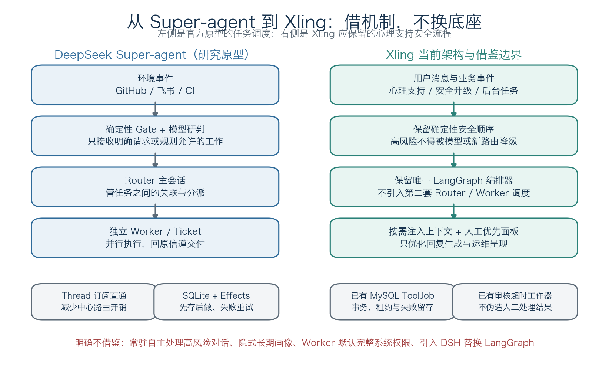
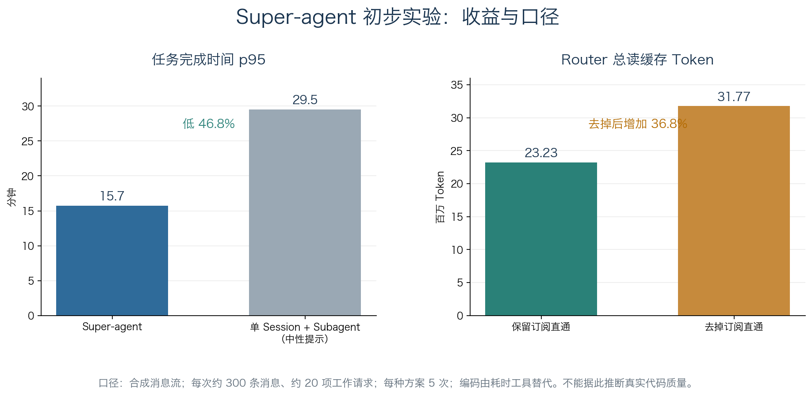

# DeepSeek Super-agent 调研及其对 Xling 的借鉴价值

日期：2026-11-04  
范围：官方设计文章对应的公开原型、官方仓库文档、公开实验与部署说明；对照 Xling 当前代码、主规格和已接受架构决策。本文只做调研与后续增量建议，不改变现有架构决策。

## 执行摘要

DeepSeek 在 2026 年 10 月 31 日公开的 Super-agent，不是新模型，也不是可直接投产的正式产品，而是一套持续在线、事件驱动、能够并行推进多项工作的 Agent 系统架构，以及一个用于验证思路的开源研究原型。它要解决的主要矛盾不是单个模型会不会写代码，而是当人同时推进很多任务时，会话切换、上下文同步、任务分派和结果跟踪会消耗大量注意力。其公开仓库明确提醒：代码仅供研究参考，可能包含缺陷，公开版与内部版本及设计文章并不完全一致，文章中的部分设计仍是未来方向。[官方原型 README](kimi-cite://web?url=https%3A%2F%2Fgithub.com%2Fdeepseek-ai%2Fdsh-superagent-prototype "citation")

对 Xling 最有价值的结论是“借机制，不换底座”。Xling 已经有唯一 LangGraph 编排器、明确的 GraphState、安全风险评估顺序、持久检查点、数据库事务、持久化工具队列、人工支持状态机和结构化诊断，不需要再引入一套 Router／Worker 调度系统，更不应让自主 Agent 接管高风险心理支持。建议优先验证两项小改动：一是减少回复生成时历史、摘要和知识内容的重复注入，二是把现有审核、失败任务和运行异常整理成“需要人处理优先”的运维视图。主动规则只用于非临床、低风险的后台场景，并先以 observe（只记录、不执行）方式验证；不采用隐式长期记忆、云端自主处理敏感对话和 Worker 默认完整系统权限。

| 判断 | 结论 | 对 Xling 的动作 |
| --- | --- | --- |
| 是否引入 DeepSeek Harness | 不建议。它是另一套仍在开发者预览期的 Agent 运行时 | 保留 LangGraph 唯一编排 runtime |
| 是否改成 Router／Worker 多 Agent | 不建议。两者解决的问题不同 | 保留当前单轮顺序安全流程 |
| 是否借鉴事件驱动 | 限定借鉴。现有超时、提醒和工具任务已经体现这一思想 | 只扩展确定性后台事件，不自主判断用户风险 |
| 是否借鉴 Inline & Spill | 值得优先验证 | 优化回复上下文，不改变安全分类输入与风险顺序 |
| 是否借鉴人工注意力原则 | 值得优先验证 | 聚合现有“待接手、待回复、失败、异常”事项 |
| 是否借鉴投机执行 | 不用于用户心理支持 | 不预先生成风险结论，不主动打扰用户 |
| 是否借鉴长期链式召回 | 只借稳定关联，不借隐式画像 | 复用 run、report、review、job 等现有 ID |

## 1. 发布对象与核心问题

### 1.1 它是一套架构与研究原型，不是新模型

Super-agent 的公开实现名为 `dsh-superagent-prototype`，采用 MIT 许可证，面向一个 GitHub 仓库，可选接入飞书。获准的人提出请求后，系统建立一个工作项，在独立 Agent 会话和目录中执行，再回到原来的 Issue、Pull Request 或群聊交付结果。它依赖 DeepSeek Harness（简称 DSH）运行；DSH 是“一切皆插件”的底层 Agent 运行时，本身也处于开发者预览阶段，并明确提示可能发生不兼容变更。因此，“采用 Super-agent”不等于调用一个 DeepSeek API，而意味着引入另一套运行时、插件、账号和运维体系。[DeepSeek Harness 官方仓库](kimi-cite://web?url=https%3A%2F%2Fgithub.com%2Fdeepseek-ai%2Fdeepseek-harness "citation")

官方设计强调四种形态：连续、高效、主动和持久。连续指跨会话与跨信道保持同一件工作的上下文；高效指多个复杂任务并行而互不干扰；主动指没有人直接 @ 它时，也能按团队规则识别值得处理的事件；持久指人关闭电脑后，系统仍能保存状态、等待事件或继续适合后台完成的工作。这些特征描述的是系统形态，不代表公开原型已经完整实现所有目标，尤其不能把内部实例的能力直接当成开源代码的能力。[官方设计报道](kimi-cite://web?url=https%3A%2F%2Fwww.ithome.com%2F1%2F020%2F615.htm "citation")

### 1.2 它优化的是人的注意力，而不只是模型吞吐

传统单 Session Agent 把“一次对话”当作用户管理任务的边界。任务一多，人需要记住哪个窗口处理哪件事、补充哪些背景、哪个任务正在等待，以及结果应该回到哪里。Super-agent 把这些管理工作下沉到系统：用户面对的是一件持续存在的工作，而不是一批需要手工维护的模型会话。其设计原则甚至把每条通知、每个问题、每个设置项和每个面板元素都视为注意力成本，只有收益高于成本才保留。[官方设计原则](kimi-cite://web?url=https%3A%2F%2Fraw.githubusercontent.com%2Fdeepseek-ai%2Fdsh-superagent-prototype%2Fmain%2Fdocs%2F000-philosophy.md "citation")

这个视角对 Xling 有启发，但不能直接翻译成“让 AI 更主动地和用户聊天”。心理支持场景中的注意力原则主要应服务于授权审核人员和运维人员：减少他们在审核列表、失败任务、通知记录和日志之间来回查找的成本。对于正在接受支持的用户，系统仍应保持清晰、可预期和低打扰，尤其不能因为环境事件或模型推断而自动改变风险等级、恢复常规回复或宣称现实专业支持已经完成。Xling 主规格已经明确区分入队、送达、人工处理和现实服务结果，这一边界应当继续保留。[Xling 主规格](kimi-cite://web?url=https%3A%2F%2Fgithub.com%2Fassle%2FXLing-agent%2Fissues%2F14 "citation")

## 2. Super-agent 的核心内容

### 2.1 双层架构：Router 管任务之间，Worker 管一件事之内

Router 是常驻主会话，负责事件研判、任务关联、接单、停止、附加到已有工作和统一对外回复；Worker 是独立执行会话，每个工作项拥有自己的上下文和目录，负责具体执行。Router 不深入每项工作的内部拆解，Worker 不直接向外发言。这与“给一个主 Agent 增加子 Agent 工具”不同：后者仍可能让主会话同时承担具体执行、调度和外部交互，模型是否委派还受提示词影响；Super-agent 则把职责隔离写进系统结构。[官方领域模型](kimi-cite://web?url=https%3A%2F%2Fraw.githubusercontent.com%2Fdeepseek-ai%2Fdsh-superagent-prototype%2Fmain%2Fdocs%2F001-domain.md "citation")

事件进入后先形成不可变 Trigger，并归属于一个或多个 Thread。确定性 Gate 先判断发送者、来源和准入规则，模型只对需要语义判断的候选事件做评估。接单后形成 Ticket 和不可变 Mandate，后者记录这项工作被允许的原因、范围和策略版本。已有 Ticket 订阅 Thread 后，后续事件可由程序直接扇出给对应 Worker，不必再次经过 Router；这种“订阅直通”传递上下文，但不自动授予新权限。超出原工作范围的人类后续请求应退回重新研判，而不是让 Worker 自行扩权。[官方授权模型](kimi-cite://web?url=https%3A%2F%2Fraw.githubusercontent.com%2Fdeepseek-ai%2Fdsh-superagent-prototype%2Fmain%2Fdocs%2F002-authorization.md "citation")

### 2.2 上下文管理：Inline & Spill 与链式召回

Inline & Spill 把模型上下文窗口当作有限缓存：近期高概率需要的信息直接 Inline；超长或低频内容 Spill 到窗口之外，只保留摘要、稳定 ID 和继续读取的入口。初始注入从最少信息开始，再按关联和时间邻近性逐步扩展。链式召回进一步让 Trigger、Thread、Worker Session 等对象通过 ID 连成引用关系，模型可以从当前事件读取所在讨论，再找到相关工作项和历史执行会话，而不是把全部历史一次性塞入提示词。[官方设计全文转载](kimi-cite://web?url=https%3A%2F%2Fm.zhidx.com%2Fp%2F606311.html "citation")

这一机制的价值不在于“记忆越多越好”，而在于保留可追溯关系的同时降低每轮输入量。不过，公开原型只体现了有界上下文读取、资源引用和持久化记录等基础，不能把文章中的完整多跳召回效果都视为已经验证。对涉及敏感数据的系统，按需读取还必须是服务端受控能力，不能让模型借“召回”绕过用户授权、会话归属、无记忆模式或最小必要信息边界。

### 2.3 主动执行、异步交互与低打扰输出

Super-agent 允许团队写下主动工作规则，例如群内出现软件问题后先在后台复现并寻找修复方案，只有确认问题且找到简单修复时才交付，否则保持安静。这属于投机执行：用额外后台计算换取更短的人类等待时间，结果没有价值就丢弃。主动模式分为 off、observe 和 auto，公开原型默认 observe，即记录“本会接受什么”但不真正执行；只有明确请求不受这一限制。该渐进方式是自主系统重要的治理手段，而不是简单的提示词技巧。[官方授权模型](kimi-cite://web?url=https%3A%2F%2Fraw.githubusercontent.com%2Fdeepseek-ai%2Fdsh-superagent-prototype%2Fmain%2Fdocs%2F002-authorization.md "citation")

在交互上，文章提出把耗时工具从同步 `run()` 改成异步 `start()`／`stop()`，让后台执行结果作为新事件返回，前台在当前推理步结束后即可接收新消息。公开原型采用超过 5 秒转后台等机制获得部分异步效果，但完整异步任务机制并未默认开启。对外回复按信道控制信息密度：即时通讯只问具体问题、提供简短结论，详细过程和工具调用留在 Worker；GitHub 等工作界面则保留完整结果。核心不是机械限制字数，而是只在需要决策、验收、结果可用或无法完成时打扰人。[官方执行模型](kimi-cite://web?url=https%3A%2F%2Fraw.githubusercontent.com%2Fdeepseek-ai%2Fdsh-superagent-prototype%2Fmain%2Fdocs%2F003-execution.md "citation")

### 2.4 持久化、恢复与外部 Watchdog

公开原型使用单一 SQLite 数据库存储 Trigger、Thread、Ticket、Assignment、设置、提示词版本和对外消息回执。Engine 是核心状态的唯一写入者，每次命令在事务中更新状态并排入外部副作用，提交后才真正执行。Effects 队列支持幂等键、并发限制、指数退避和失败记录；重启后能够恢复中断的 Assignment、未读输入和待发送消息。这里的“存算分离”首先是状态持久化与执行解耦，不应被误解为公开原型已经完成云端无状态计算和多设备 daemon。[官方架构文档](kimi-cite://web?url=https%3A%2F%2Fraw.githubusercontent.com%2Fdeepseek-ai%2Fdsh-superagent-prototype%2Fmain%2Fdocs%2F007-architecture.md "citation")

文章中的 Watchdog 是主系统之外的控制回路，不只检查接口和进程错误，还希望判断 Worker 是否没有实质进展或方向偏离。公开部署文档提供的是状态脚本和每小时外部检查：正常时保持安静，普通运行故障可尝试重启，配置或部件错误则报告给人，并尊重人工停止。它比“再开一个 Agent 自动修所有问题”更克制，也更适合作为其他系统的借鉴起点。[官方部署文档](kimi-cite://web?url=https%3A%2F%2Fraw.githubusercontent.com%2Fdeepseek-ai%2Fdsh-superagent-prototype%2Fmain%2Fdocs%2F006-deployment.md "citation")

| 模块 | 官方设计目标 | 公开原型状态 | 不能误读为 |
| --- | --- | --- | --- |
| Router／Worker | 多任务并行、职责隔离 | 已实现主会话、工单、独立执行会话和目录 | 已证明适合所有业务的多 Agent 通用架构 |
| 事件驱动 | 两级过滤、订阅直通、主动规则 | 已实现 GitHub、飞书、Gate、Mandate、observe／auto | 环境消息可以直接改变系统权限 |
| 上下文管理 | Inline & Spill、链式召回 | 有界读取和引用基础已具备，完整效果仍在探索 | 已解决跨月或跨组织长期记忆 |
| 异步多信道 | 后台执行不阻塞前台，按信道输出 | 部分实现；完整异步 start／stop 未默认开启 | 所有工具调用都已全双工 |
| 存算分离 | 状态持久化，计算与执行环境解耦 | SQLite 与恢复机制已实现；云端和端侧 daemon 属不同成熟度 | 开源版已经完成多设备云端架构 |
| Watchdog | 外部发现卡死、无进展和跑偏 | 有状态脚本与定时外部检查 | 自主修复能力已经充分验证 |

## 3. 公开实验及其证据边界

### 3.1 调度与上下文开销的初步结果

官方初步实验使用群聊和 GitHub CI 消息流，每次约 300 条消息，其中约 20 条为工作请求，每种方案重复 5 次。Super-agent 的任务完成时间 p50 为 12.4 分钟、p95 为 15.7 分钟；单 Session 加 Subagent 工具在中性提示下的 p95 为 29.5 分钟。按这两个 p95 数值计算，Super-agent 低约 46.8%。中性提示下，对照方案 5 次都没有调用 Subagent，说明“把委派工具交给模型”并不保证系统真的会并行；但这只是特定提示与负载下的结果，不是对所有单会话方案的普遍结论。[实验数据报道](kimi-cite://web?url=https%3A%2F%2Fwww.donews.com%2Fnews%2Fdetail%2F1%2F6760986.html "citation")

去掉订阅直通后，完成时间基本不变，但 Router 决策次数增加约 30%，总读缓存 Token 从 2323 万升至 3177 万，增加约 36.8%；反过来，保留直通相对去掉直通减少约 26.9%。Router 压测中，Trigger 到达速率从每分钟约 1 条升至约 40 条，平均批大小从 1.0 增至 2.8，单次请求耗时从 2.5 秒增至 3.9 秒，单个决定分摊的推理时间从 6.4 秒降至 1.6 秒。它支持“批量处理积压事件可提高有效吞吐”，但也说明系统收益来自具体工程机制，而不是“Super-agent”这个名称本身。[实验与批处理报道](kimi-cite://web?url=https%3A%2F%2Fm.zhidx.com%2Fp%2F606311.html "citation")

| 指标 | Super-agent／保留直通 | 对照／去掉直通 | 可以支持的判断 |
| --- | --- | --- | --- |
| 完成时间 p50 | 12.4 分钟 | 单 Session 中性提示的对应值未披露 | 不能补算或猜测对照 p50 |
| 完成时间 p95 | 15.7 分钟 | 29.5 分钟 | 本实验中长尾完成时间更短 |
| Router 读缓存 Token | 2323 万 | 3177 万 | 直通降低中心路由上下文开销 |
| Router 决策次数 | 基准 | 增加约 30% | 程序直通替代了重复语义路由 |
| 单决定分摊推理时间 | 高负载下 1.6 秒 | 低负载下 6.4 秒 | 批处理提高路由有效吞吐 |

### 3.2 这些结果没有证明什么

实验中的编码工作由只消耗时间的工具替代，因此测量的是调度、协作和等待，不是实际代码质量、修复正确率或评审通过率。样本是合成负载与简化环境，每种方案仅运行 5 次，也没有覆盖真实团队的权限差异、需求歧义、跨仓库依赖和长期运维。多 Session 本身的读缓存 Token 高于单 Session，意味着它可能是在用更多模型开销换取更短、更稳定的完成时间，而不是绝对降低成本。[实验限制说明](kimi-cite://web?url=https%3A%2F%2Fwww.huxiu.com%2Farticle%2F4902022.html "citation")

官方还明确列出四类开放问题：单 Router 何时以及如何扩展、跨月长期记忆、执行过程中的人机接管与协作、不同权限边界实例之间的 A2A 通信，以及安全和隐私。尤其是云端 Agent Loop 接收不可信环境输入、端侧设备又持有私有代码和凭据时，提示词注入或服务端入侵可能把风险扩散到所有连接设备。公开部署文档也承认 Worker 以操作者 OS 用户运行完整权限，账号包装器不构成隔离；生产使用至少需要专用 OS 账号，敏感环境还应采用更强的隔离与凭据代理。[官方开放问题](kimi-cite://web?url=https%3A%2F%2Ffinance.eastmoney.com%2Fa%2F202610313917654063.html "citation")

## 4. 与 Xling 当前架构的对照

### 4.1 Xling 已经具备的基础，不应重复建设

Xling 当前是“一个编排器 + 多个专职智能体角色”，所有角色在同一应用进程中由 LangGraph 图和条件边连接。每个节点读取 GraphState 的明确字段并返回更新，每条新消息重新初始化本轮状态，只白名单恢复次日反馈等跨轮对象状态。这与 Super-agent 的 Ticket／Worker 不是一个层次：Xling 的多个角色共同完成一条有严格安全顺序的支持流程，而不是并行承接多个独立工单。现有 ADR 还明确 LangGraph 是唯一编排框架，因此引入第二套路由和任务状态协议会直接增加一致性风险。[README](kimi-cite://md-line?path=%2FUsers%2Fassle%2Fdev%2Fmindbridge-py%2FREADME.md&line=25&text=LangGraph "citation"), [ADR-0012](kimi-cite://md-line?path=%2FUsers%2Fassle%2Fdev%2Fmindbridge-py%2Fdocs%2Fadr%2F0012-langgraph-runtime-and-local-diagnostics.md&line=11&text=LangGraph "citation")

项目也已经有持久化与恢复基础：默认 AsyncSqliteSaver 保存图检查点，Redis 保存短期会话和四维追问状态，MySQL 保存业务事实。安全评估、人工支持请求与 ToolJob 在事务中统一保存，表格和通知由后台工作器领取、执行、重试，超过次数后进入 DeadLetterRecord；执行中任务还有租约恢复。人工支持则使用 pending、in_progress、monitoring、referred、completed 等业务状态，超时只追加升级审计和通知，不伪造现实处理结果。这些都与 Super-agent 的“先存后做、状态机、失败恢复、人工负责”思想相通。[support_turn](kimi-cite://md-line?path=%2FUsers%2Fassle%2Fdev%2Fmindbridge-py%2Fapp%2Fservices%2Fsupport_turn.py&line=120&text=%23%20%E6%AD%A4%E5%A4%84%E4%BB%85%E7%99%BB%E8%AE%B0%E5%BE%85%E6%89%A7%E8%A1%8C%E4%BB%BB%E5%8A%A1 "citation"), [tool_queue](kimi-cite://md-line?path=%2FUsers%2Fassle%2Fdev%2Fmindbridge-py%2Fapp%2Fservices%2Ftool_queue.py&line=349&text=def%20_fail_or_dead_letter "citation"), [ADR-0018](kimi-cite://md-line?path=%2FUsers%2Fassle%2Fdev%2Fmindbridge-py%2Fdocs%2Fadr%2F0018-high-risk-human-support.md&line=15&text=%E4%BA%BA%E5%B7%A5%E6%94%AF%E6%8C%81%E7%8A%B6%E6%80%81 "citation")

| Super-agent 的设计 | Xling 当前对应能力 | 调研判断 |
| --- | --- | --- |
| 确定性 Gate 先于模型研判 | 明确风险规则优先；支持消息先评估风险，再检索与生成 | 保留，不能用自主路由绕开 |
| 每轮状态明确、可持久恢复 | GraphState 每轮初始化，SQLite 检查点白名单恢复跨轮状态 | 保留，不引入通用任务暂停栈 |
| 先存后做的副作用队列 | SupportTurnTransaction + ToolJob + 租约 + 失败留存 | 保留并复用，不新增 Effects 框架 |
| 人工决策与业务状态分离 | ReviewRequest、负责人、站内回复、站外联系、处置与审计 | 保留，通知不等于现实服务 |
| 低打扰与人工优先 | 活跃审核按风险和等待排序，管理端已有任务记录 | 可做聚合呈现，不需新建一套系统 |
| 结构化诊断与稳定 ID | run、report、review、job 等 ID 已贯穿诊断 | 可加强跨页面定位，不需图数据库 |
| 用户可见的长期记忆 | 支持背景与用户确认的记忆卡片；无记忆会话受控 | 不改成自动多跳画像 |

### 4.2 根本差异决定了不能照搬 Router／Worker

Super-agent 的典型工作是“收到一个开发请求，在独立目录中修改代码并提交 Pull Request”。不同工单可以并行，上下文和目录隔离有利于减少相互污染。Xling 的典型工作则是“理解当前用户这一轮表达，在已授权背景和严格安全顺序下给出支持”。其中记忆、消息分流、安全风险评估、知识检索、四维追问和回复生成存在明确依赖，尤其高风险必须在知识检索和常规生成之前结束自动路径。把这种顺序流程拆成自由协作的 Worker，不会自然带来收益，反而会增加风险状态不一致和重复回复的可能。[langgraph_runtime](kimi-cite://md-line?path=%2FUsers%2Fassle%2Fdev%2Fmindbridge-py%2Fapp%2Fagents%2Flanggraph_runtime.py&line=317&text=graph.add_edge%28%22memory%22%2C%20%22supervisor%22%29 "citation"), [ADR-0010](kimi-cite://md-line?path=%2FUsers%2Fassle%2Fdev%2Fmindbridge-py%2Fdocs%2Fadr%2F0010-safety-assessment-before-knowledge.md&line=3&text=%E9%AB%98%E9%A3%8E%E9%99%A9 "citation")

Xling 当前单进程对同一会话只允许一轮执行，不同会话可以并行，但不宣称多 worker 或多主机协调。Super-agent 的分布式愿景不能用来掩盖这一边界；同样，Xling 也不需要为了“看起来先进”提前引入云端无状态容器、端侧 daemon 和跨实例 A2A。只有当未来出现明确的多机构、多主机或大量独立后台工作需求，并且现有单机队列已经成为可测量瓶颈时，才值得另行评估更复杂的调度架构，那应是独立决策，而不是本次调研的默认结论。

## 5. 值得借鉴的具体方向

### 5.1 优先级一：为回复生成建立上下文预算与去重机制

当前 MemoryAgent 每轮读取近期消息，并用模型对最近历史生成 1—3 条摘要；随后回复节点同时携带 model_history、memory_brief、支持背景、已确认记忆和检索知识。知识检索已有 3072 字上下文上限，但历史与摘要仍可能重复表达同一内容，摘要也需要每轮一次模型调用。可以借鉴 Inline & Spill 的思想，先测量各部分字符数、估算 Token、重复率和阶段耗时，再验证“摘要 + 最近必要消息 + 受控续读”是否能在保持质量的同时减少输入与延迟。最小候选优化是缓存与历史版本对应的摘要、避免同一消息在摘要和全文中无差别重复，而不是立即新增自主检索工具。[langgraph_runtime](kimi-cite://md-line?path=%2FUsers%2Fassle%2Fdev%2Fmindbridge-py%2Fapp%2Fagents%2Flanggraph_runtime.py&line=487&text=async%20def%20_memory_node "citation"), [langgraph_runtime](kimi-cite://md-line?path=%2FUsers%2Fassle%2Fdev%2Fmindbridge-py%2Fapp%2Fagents%2Flanggraph_runtime.py&line=829&text=async%20def%20_summarize_memory "citation")

这一优化只能作用于普通回复生成上下文，不能删减安全风险评估所需的当前文本、明确规则和风险轨迹，也不能绕过无记忆会话。按需读取必须由服务端限制在当前用户、当前会话和用户已授权的数据范围内，诊断只记录长度、数量和耗时，不记录用户正文或完整提示。验收应同时包含固定回复质量、端到端安全流程、无记忆隔离、延迟和 Token 对比；若质量或安全指标回退，就不采用。也就是说，先证明“重复信息确实造成成本”，再选择最小改法，而不是为了套用新名词重写 MemoryAgent。

### 5.2 优先级一：把运维首页改为“需要人处理优先”

Super-agent 的面板把等待人处理的事项放在前面，健康状态不占注意力。Xling 已有活跃审核排序、后台任务和失败记录，也有 run、report、review、job 等关联 ID，可以在现有管理后台增加一个聚合视图：待接手与等待时长、待人工回复、持续关注到期、通知最终失败、工具任务死信和需要修复的运行异常分别呈现，并链接到原有详情页。这里不需要新事件总线或新数据库，只需要组合已有状态，避免维护两套事实来源。[review](kimi-cite://md-line?path=%2FUsers%2Fassle%2Fdev%2Fmindbridge-py%2Fapp%2Fservices%2Freview.py&line=199&text=def%20list_active "citation"), [diagnostics](kimi-cite://md-line?path=%2FUsers%2Fassle%2Fdev%2Fmindbridge-py%2Fapp%2Fcore%2Fdiagnostics.py&line=24&text=_FIELDS "citation")

视图必须保持业务语义：待接手不等于专业人员已经知道，通知成功不等于人工已经处理，持续关注到期只代表提醒，技术完成不等于现实服务完成。正常状态可以折叠，但高风险未接手和通知最终失败不能因为是“旧任务”而静默消失。验收应覆盖权限、脱敏、状态映射和链接定位，并确认列表不会把原消息或最近上下文误标为“已全面脱敏”。这项借鉴直接减少授权审核人员和技术人员的查找成本，比增加自主 Agent 更符合 Xling 的实际瓶颈。

### 5.3 优先级二：主动规则先 observe，只用于非临床后台场景

Xling 已经有确定性后台触发：ReviewTimeoutWorker 定期检查人工支持超时和持续关注到期，ToolQueueWorker 定期领取任务、恢复租约和重试失败。未来如果要增加更复杂的主动规则，例如发现知识索引连续校验失败、通知多次降级或后台任务长期无进展，应复用这些持久状态与工作器，先记录“若启用会采取什么动作”，由人检查候选准确性和通知价值后，再决定是否自动执行。observe 的价值是把规则质量变成可审查证据，而不是让模型直接获得新的行动权限。[review](kimi-cite://md-line?path=%2FUsers%2Fassle%2Fdev%2Fmindbridge-py%2Fapp%2Fservices%2Freview.py&line=544&text=def%20run_once "citation")

边界必须同时写清：不让模型从群聊、历史对话或外部文档自主推断用户风险并发起临床处置；不自动恢复高风险会话的 AI 回复；不因为“投机执行”而提前生成诊断、量表分数或人格画像；不向用户发送没有明确价值的主动消息。对非临床后台任务，可以先从确定性代码开始，只有确实需要语义理解且误报成本可控时才引入模型评估。高风险通知仍应即时发送，不能为了降低通知数量而批处理或延迟。

### 5.4 优先级二：Watchdog 先做确定性健康检查，不做自我修改 Agent

当前代码已经记录工具队列和审核超时工作器的降级事件，但 Watchdog 思想提醒我还应区分“进程活着”和“工作真的在推进”。可检查现有健康接口后，补充少量确定性信号：最近一次成功调度时间、连续失败次数、最老待处理任务等待时间、租约恢复次数、审核超时工作器最近成功轮次，以及通知最终失败数量。只有超过明确阈值且需要人修复时才显示或通知，正常时保持安静。所有指标使用计数、时间和 ID，不把敏感对话内容交给另一个模型判断。[tool_queue](kimi-cite://md-line?path=%2FUsers%2Fassle%2Fdev%2Fmindbridge-py%2Fapp%2Fservices%2Ftool_queue.py&line=204&text=def%20_loop "citation")

不建议引入能够在线修改提示词、权限和业务规则的自主 Watchdog。它在研发原型中可能方便，但在心理支持系统里会形成新的高权限控制面。Xling 更需要可解释、可测试、可暂停的外部检查：进程失效可以按既有部署策略重启，配置错误、通知失败和安全相关异常必须报告给人，自动恢复不得改变人工支持状态或伪造处理结果。

### 5.5 优先级三：用现有稳定 ID 做“链式定位”，而不是新建记忆图谱

Xling 的诊断已经能按 run_id 关联图节点、分支、回复生成与保存，并通过 report_id、review_id、job_id 连接后续任务。可以借鉴链式召回的呈现方式，让一次执行记录能跳转到对应安全评估、人工支持和工具任务，让审核记录能定位相关审计与通知结果。这对排查“为什么这条消息进入人工支持”“通知最终是否成功”“任务是否重试”很有帮助，而且只是利用既有关系，不需要把用户历史加工成新的知识图谱。[diagnostics](kimi-cite://md-line?path=%2FUsers%2Fassle%2Fdev%2Fmindbridge-py%2Fapp%2Fcore%2Fdiagnostics.py&line=104&text=def%20_write "citation")

长期记忆仍应坚持用户可查看、确认、修改和删除的支持背景与记忆卡片。稳定 ID 用于审计和定位，不应演变成模型可自由漫游的隐式个人档案；无记忆会话、账户删除、数据归属和最少必要展示必须继续生效。链式召回在 Xling 中更适合做“可追溯执行链”，不适合做“不可见用户画像”。[ADR-0008](kimi-cite://md-line?path=%2FUsers%2Fassle%2Fdev%2Fmindbridge-py%2Fdocs%2Fadr%2F0008-explicit-memory-cards-not-implicit-profile.md&line=3&text=%E9%95%BF%E6%9C%9F%E8%AE%B0%E5%BF%86%E9%87%87%E7%94%A8 "citation")

## 6. 明确不建议采用的做法

| 不建议做法 | 原因 | 可替代方案 |
| --- | --- | --- |
| 引入 DSH 并替换 LangGraph | 形成第二套编排与状态事实来源，且 DSH 仍在预览期 | 保留现有图，局部优化上下文和运维 |
| 把七个专职角色改成自由协作 Worker | 当前流程有强依赖和安全顺序，并行化收益不明确 | 保留确定性条件边和每轮状态 |
| 让 Agent 监听对话并自主处理高风险 | 可能扩大权限、误报漏报并削弱专业职责 | 沿用风险评估、固定确认与人工支持 |
| 对心理支持使用投机执行 | 无明确请求的计算可能增加隐私暴露和无效打扰 | 只处理用户本轮明确输入与既定后台任务 |
| 自动构建长期链式用户记忆 | 与知情、可管理、无记忆和最少必要原则冲突 | 用户确认的记忆卡片与受控短期上下文 |
| 云端 Agent 连接本地完整权限和凭据 | 提示词注入可能扩散为设备与数据风险 | 单机最小权限、凭据代理、敏感操作人工确认 |
| 让 Watchdog 自主修改规则和提示词 | 形成难以审计的高权限控制面 | 确定性健康检查、版本化配置、人工审批 |

这些否定项不是认为 Super-agent 的设计错误，而是适用领域不同。它在受控研发团队和代码任务中可以用独立账号、白名单、工作目录、评审和 Pull Request 形成约束；Xling 处理的是敏感心理支持数据与专业责任，错误主动行动的代价更高。架构借鉴必须保留原有安全、隐私和人工职责约束，而不能只复制“自主、持久、并行”这些表面特征。

## 7. 建议的最小下一步

建议先做一个不改变业务流程的“回复上下文观测与去重实验”。在固定评测集上记录各上下文部分的字符数或估算 Token、记忆摘要模型调用次数、图阶段耗时、首 token 时间和最终回复质量；随后仅对记忆摘要缓存、历史与摘要去重做一个候选实现，与当前版本对照。实验日志继续只保存数量和 ID，不保存用户正文。只有结果显示成本确有下降，且安全、无记忆、行动计划、次日反馈和回复质量没有回退，才进入正式 ADR 与任务实施。

第二步再做“需要人处理优先”的管理端聚合视图，因为它主要重排已有事实，风险低、收益容易验证。主动 observe 规则、确定性 Watchdog 和跨页面执行链定位可以作为后续独立增量，分别评估，不应打包成一次“大 Super-agent 改造”。每个增量都应先写清要解决的测量问题、保持不变的边界和回退条件，再选择最小实现。

| 顺序 | 候选增量 | 主要验证指标 | 不变的安全边界 |
| --- | --- | --- | --- |
| 1 | 上下文观测、摘要缓存与去重实验 | 输入量、模型调用、延迟、回复质量 | 风险输入、无记忆、数据归属不变 |
| 2 | 需要人处理优先的管理端聚合视图 | 查找路径、状态准确性、权限与脱敏 | 通知、人工处理、现实结果不混同 |
| 3 | 确定性后台健康信号 | 故障发现时间、误报、重复通知 | 正常静默，异常不自动改业务状态 |
| 4 | 非临床主动规则 observe | 候选准确率、动作价值、人工审核结果 | 默认不执行，不接触临床自主决策 |
| 5 | 基于现有 ID 的执行链定位 | 排查时间、跳转正确性、信息暴露 | 不建立隐式用户记忆图谱 |

最终建议可以概括为一句话：**Xling 应学习 Super-agent 对注意力、上下文和持久工程的管理方式，而不是复制它的多 Agent 形态。** 当前最合理的路线是“小步测量、局部借鉴、安全边界不动”，而不是引入一套新的 Agent 平台。
